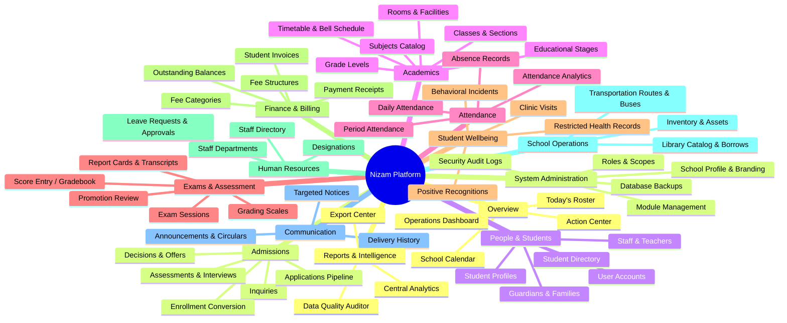

# NIZAM UNIVERSAL SCHOOL PLATFORM -- ADMINISTRATIVE INFORMATION ARCHITECTURE
**Product:** Nizam Universal School Platform  
**System:** Application Sitemap, Navigation Structure & Context Engine  
**Document Version:** 1.0.0

---

## 1. Information Architecture Overview

The Nizam Universal Information Architecture organizes school operations into **13 cohesive operational domains**. The top-level shell adapts dynamically based on:
1. **Activated Modules:** Disabled modules are suppressed from the sidebar.
2. **User Role & Permissions:** Non-authorized destinations are omitted.
3. **Current Operating Context:** School, Campus, Academic Year, and Active Term.

---

## 2. Universal Navigation Structure (13 Operational Domains)

---

## 3. Top-Level Navigation Groups (Sidebar Layout)

In the user interface, these 13 domains are rendered into 7 clean sidebar groups that preserve the modern light-mode design system:

### Group 1: Overview (`main`)
- **Dashboard:** `/dashboard` (Role-tailored operations center, KPI cards, Action Center, Data Quality Alerts)
- **Notifications:** `/notifications` (System alerts, reminders, message center)

### Group 2: Admissions & Enrollment (`admissions`) *(Modular)*
- **Admissions Pipeline:** `/admissions` (Application pipeline board, inquiries, entrance exam scoring, one-click enrollment)

### Group 3: Academic Operations (`academic`)
- **Academic Years & Terms:** `/academic-years` (Years, terms, date boundaries, closing)
- **Educational Stages & Grades:** `/grades` (Stages, grade hierarchy)
- **Subjects Catalog:** `/subjects` (Curriculum subjects, staffing requirements)
- **Classes & Sections:** `/classes` (Section rosters, room capacity)
- **Timetable & Bell Schedule:** `/timetable` (Weekly grid, period slots)

### Group 4: People & Families (`people`)
- **Students:** `/students` (Lifecycle directory, comprehensive student profile with 7 tabs)
- **Guardians & Families:** `/guardians` (Guardian directory, linked siblings, emergency contacts)
- **Teachers & Staff:** `/teachers` (Teacher directory, teaching assignments)
- **User Accounts:** `/users` (Platform accounts, 18 role assignments)

### Group 5: Daily School Operations (`operations`)
- **Attendance:** `/attendance` (Daily roll call, period logging, missing attendance finder)
- **Teacher Assignments:** `/assignments` (Teaching workload distribution)
- **Exams & Grading:** `/exams` (Exams, grading scale config, score entry, report cards)
- **Student Promotion:** `/students/promotion` (End-of-year rollover, grade advancing)
- **Transportation:** `/transport` *(Modular)* (Bus routes, vehicle fleet, student passenger manifests)
- **Library:** `/library` *(Modular)* (Book catalog, checkout/return desk, overdue tracking)

### Group 6: Student Wellbeing (`welfare`)
- **Disciplinary Records:** `/welfare/discipline` (Infractions, sanctions, rewards)
- **Health & Clinic Records:** `/welfare/health` (Restricted medical logs, allergies, clinic visits)

### Group 7: Business & ERP (`business`) *(Modular)*
- **Finance & Billing:** `/finance` (Fee structures, student invoices, payment receipts)
- **Human Resources:** `/hr` (Staff departments, designations, leave approvals)

### Group 8: Intelligence & Administration (`system`)
- **Reports & Data Quality:** `/reports` (Standard reports, export center, data quality audit)
- **Activity Audit Log:** `/activity-log` (Immutable security activity log)
- **School Settings:** `/settings/profile` (Branding, profile, configuration)
- **Module Manager:** `/settings/modules` (Activate/deactivate platform modules)
- **Database Backups:** `/backups` (Manual, scheduled backups, restore)

---

## 4. Universal Global Context Bar

At the top of every authenticated page, the persistent Context Bar displays:
1. **Active School Name & Logo**
2. **Campus Switcher** (for multi-campus deployments)
3. **Active Academic Year & Current Term**
4. **Current Date & Direction (RTL / LTR)**
5. **Logged-in User Badge & Role Template**
