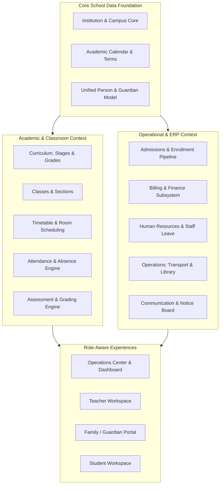
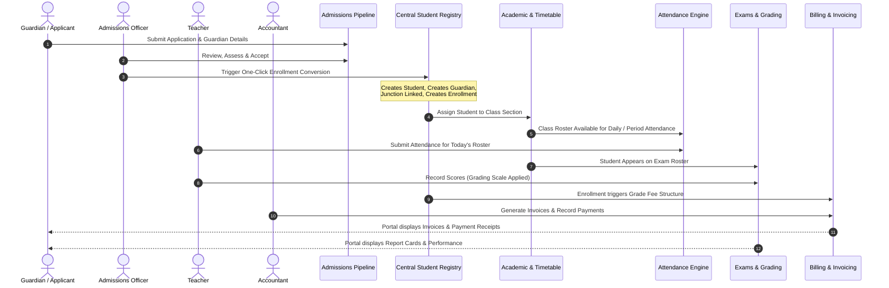

# NIZAM UNIVERSAL SCHOOL PLATFORM -- DOMAIN ARCHITECTURE & BOUNDED CONTEXTS
**Product:** Nizam Universal School Platform  
**Architecture Style:** Modular Monolith (PHP 8.2+ MVC, Strict Repository Pattern, Dual-Engine MySQL/PostgreSQL)  
**Document Version:** 1.0.0

---

## 1. Architectural Philosophy

Nizam is designed around **One Central School Data Foundation**: every department, service, and portal references a single authoritative truth. Instead of disconnected silos where Admissions, SIS, Academics, Attendance, and Finance maintain redundant student records, Nizam unifies these under cohesive Bounded Contexts.

---

## 2. Bounded Contexts & Domain Responsibilities

### 2.1 Institution & Organization Context
- **Aggregates:** `School`, `Campus`, `SchoolSettings`, `InstalledModule`.
- **Invariants:**
  - One school organization can operate multiple campuses.
  - Every academic operation (classes, rooms, students) is contextualized by campus and active academic year.
  - Modules can be enabled/disabled at the school level without breaking foreign-key integrity.

### 2.2 Unified Person & Student Lifecycle Context
- **Aggregates:** `Student`, `Guardian`, `StudentGuardian`, `EnrollmentHistory`.
- **Lifecycle States:**
  1. `Prospective`: Inquired or initiated contact.
  2. `Applicant`: Submitted application form and documents.
  3. `Under Review`: Admissions team evaluating assessments/interviews.
  4. `Accepted / Offer`: Offer extended to guardian.
  5. `Enrollment Pending`: Tuition deposit or registration paperwork awaiting finalization.
  6. `Enrolled / Active`: Officially admitted and placed in grade/class.
  7. `Promoted / Repeated`: End-of-year academic rollover status.
  8. `Transferred`: Moved to another institution (records archived).
  9. `Withdrawn`: Formally withdrew.
  10. `Graduated / Alumni`: Successfully completed highest terminal grade level.
- **Invariants:**
  - A student has exactly one active enrollment per academic year.
  - Prior academic history and enrollment records are immutable; promotions create new enrollment records linking to `previous_enrollment_id`.
  - Guardians can be linked to multiple siblings with distinct relationship roles (`father`, `mother`, `legal_guardian`, `sponsor`) and permissions (`is_primary`, `can_pickup`, `receives_reports`, `emergency_contact`).

### 2.3 Academic Structure & Curriculum Context
- **Aggregates:** `EducationalStage`, `Grade`, `ClassSection`, `Subject`, `Course`, `TimetableSlot`.
- **Invariants:**
  - Stages (e.g. Primary, Preparatory, Secondary) group grades logically.
  - Grades belong to an educational stage and define curriculum subjects.
  - Classes belong to exactly one grade and one academic year.
  - Timetable periods map teachers, subjects, and classes without conflicting slot collisions.

### 2.4 Attendance Context
- **Aggregates:** `AttendanceRecord`, `AttendanceCode`, `AttendancePolicy`.
- **Invariants:**
  - Attendance can be logged daily or per timetable period.
  - Present, Absent, Late, and Excused statuses are driven by configurable `attendance_codes`.
  - Daily submission completeness is tracked to alert administrators of missing rosters.

### 2.5 Assessment, Grading & Report Cards Context
- **Aggregates:** `GradingScale`, `GradingScaleBand`, `Exam`, `ExamScore`, `ReportCard`.
- **Invariants:**
  - Scales support Percentages (0-100), Letter Grades (A-F), GPA 4.0, or Competency Rubrics.
  - Exam weights sum to defined term weights.
  - Scores validate against exam max scores and map deterministically to scale bands.

### 2.6 Admissions & Enrollment Pipeline Context
- **Aggregates:** `AdmissionsInquiry`, `AdmissionsApplication`, `AssessmentEvaluation`.
- **Invariants:**
  - Tracks applicants independently of active students until official enrollment.
  - Conversion action atomically creates the `Student`, links `Guardian`, and creates initial `StudentEnrollment`.

### 2.7 Finance & School Billing Context (Modular & Optional)
- **Aggregates:** `FeeCategory`, `FeeStructure`, `StudentInvoice`, `InvoicePayment`.
- **Invariants:**
  - Invoices represent accounts receivable bound to student and academic year.
  - Payments increment paid amounts and generate unique receipt numbers.
  - Disabling the finance module hides routes, navigation, and billing forms without affecting SIS operation.

### 2.8 Staff & Human Resources Context (Modular & Optional)
- **Aggregates:** `StaffDepartment`, `StaffDesignation`, `EmployeeProfile`, `StaffLeave`.
- **Invariants:**
  - Teachers are employees assigned to academic departments.
  - Leave requests follow approval state machines (`pending` → `approved` / `rejected`).

### 2.9 Operations: Transport & Library Context (Modular & Optional)
- **Aggregates:** `TransportRoute`, `Vehicle`, `StudentTransportAssignment`, `LibraryBook`, `BookBorrow`.
- **Invariants:**
  - Bus routes enforce vehicle capacity limits.
  - Book borrowing enforces copy availability and tracks due/return dates and overdue state.

---

## 3. Single Source of Truth & Data Flow Diagram

---

## 4. Dual Database Dialect Parity Strategy

To ensure zero lock-in and seamless operation on both local offline setups (MySQL/MariaDB via XAMPP) and modern cloud PostgreSQL/Supabase instances:
1. All schema migrations exist in exact pairs: `database/migrations/NNN_*.sql` and `database/migrations-pg/NNN_*.sql`.
2. Repositories detect PDO driver name (`$pdo->getAttribute(PDO::ATTR_DRIVER_NAME)`) for dialect-specific syntax such as `ON DUPLICATE KEY UPDATE` (MySQL) vs `ON CONFLICT (...) DO UPDATE` (PostgreSQL).
3. Timestamps, booleans, and auto-increment sequences are handled uniformly.
