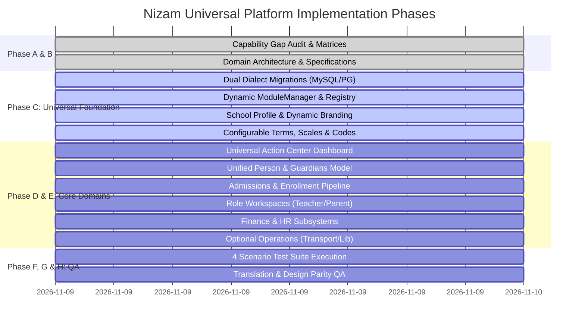

# NIZAM UNIVERSAL SCHOOL PLATFORM -- IMPLEMENTATION ROADMAP & PROGRESSION
**Product:** Nizam Universal School Platform  
**Target:** Universal K-12 School Information System (SIS) & School ERP  
**Document Version:** 1.0.0

---

## 1. Phased Roadmap Overview

---

## 2. Detailed Milestone Deliverables

### Milestone 0: Universal Foundation (Priority 0)
- [x] Gap analysis matrix (`docs/product/universal-school-platform-gap-analysis.md`).
- [x] Domain architecture document (`docs/product/domain-architecture.md`).
- [x] Module registry & dependency spec (`docs/product/module-registry-and-dependencies.md`).
- [x] Role-permission matrix (`docs/product/role-permission-matrix.md`).
- [x] School configuration spec (`docs/product/school-configuration-specification.md`).
- [x] Admin information architecture (`docs/product/admin-information-architecture.md`).
- [x] Multi-campus ADR (`docs/product/multi-campus-and-tenancy-decision.md`).
- [x] Onboarding guide (`docs/product/school-onboarding-guide.md`).
- [x] Interoperability strategy (`docs/product/interoperability-strategy.md`).
- [x] Database migrations: MySQL (`019_universal_platform_foundation.sql`) & PostgreSQL (`023_universal_platform_foundation.sql`).
- [x] `App\Services\ModuleManager` implementation with route gating and nav filtering.
- [x] Institution settings expansion in `SchoolRepository` and `SettingsRepository`.
- [x] Configurable grading scales (`grading_scales`) and terms (`academic_terms`) -- CRUD, validation and bilingual screens at `/settings/structure`, `/settings/terms`, `/settings/grading`, covered by `tests/academic-configuration.php`.
- [x] Role template permissions (migrations `020` MySQL / `024` PostgreSQL).
- [x] Resolve grading bands inside score entry, ranking, report cards and transcripts via one shared calculation service (`AcademicCalculationService`, covered by `tests/academic-calculation.php`).
- [ ] Configurable assessment categories (coursework / midterm / final) with their own weights; weighting is currently per exam.
- [ ] Campus configuration and campus-scoped queries (`campuses` is schema-only).

### Milestone 1: Professional School Operations (Priority 1)
- [ ] Action-oriented Dashboard with Context Switcher, Action Center, and Data Quality Auditor.
- [ ] Guardian Directory & Student Multi-Guardian relationships.
- [ ] Admissions Pipeline: Inquiries, Applications board, Assessments, and one-click Enrollment Conversion.
- [ ] Role Workspaces: Teacher Portal (`/portal/teacher`), Parent Portal (`/portal/family`), Student Portal (`/portal/student`).
- [ ] Finance & Billing Subsystem (`/finance`): Fee structures, Student Invoices, Payment Receipts.
- [ ] Human Resources Subsystem (`/hr`): Departments, Designations, Leave Request workflow.

### Milestone 2: Optional Specialist Modules (Priority 2)
- [ ] Transportation Management (`/transport`): Routes, vehicles, drivers, student allocations.
- [ ] Library Management (`/library`): Catalog, book copies, checkout/return desk, overdue lists.
- [ ] 11-step Setup Onboarding wizard with operational readiness check.

### Milestone 3: Verification, Scenario Testing & Release Readiness
- [ ] Isolated Test Scenario A: Small Primary School.
- [ ] Isolated Test Scenario B: Large Bilingual Language School.
- [ ] Isolated Test Scenario C: International School (GPA/Letter grades).
- [ ] Isolated Test Scenario D: Multi-Campus Institution.
- [ ] Translation parity test verification (`lang/ar.php` & `lang/en.php`).
- [ ] Zero regression on baseline test suite (`legacy-smoke.php`, `exam-integrity.php`, etc.).
