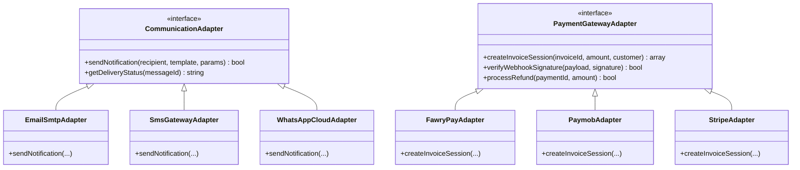

# NIZAM UNIVERSAL SCHOOL PLATFORM -- DATA INTEROPERABILITY & INTEGRATIONS STRATEGY
**Product:** Nizam Universal School Platform  
**Standards:** 1EdTech OneRoster v1.2, Ed-Fi Data Standard Concepts, Pluggable Adapters  
**Document Version:** 1.0.0

---

## 1. Interoperability Vision

A modern School Information System cannot remain an isolated island. Nizam is engineered to support seamless data exchange with ministries of education, national reporting systems, learning management systems (Moodle, Canvas, Google Classroom), and external financial/messaging services while strictly safeguarding student privacy and offline self-sufficiency.

---

## 2. 1EdTech OneRoster v1.2 Alignment

Nizam aligns its core entity exports and schema structures with the **1EdTech OneRoster v1.2** specification. This provides instant compatibility with international digital curriculum providers, educational tools, and district aggregators.

### 2.1 OneRoster Entity Mapping

| OneRoster v1.2 CSV Table | Nizam Authoritative Entity | Key Attributes Mapped |
|---|---|---|
| `orgs.csv` | `schools` / `campuses` | `sourcedId`, `name`, `type` ('school', 'district'), `identifier` |
| `academicSessions.csv` | `academic_years` / `academic_terms` | `sourcedId`, `title`, `type` ('schoolYear', 'semester', 'term'), `startDate`, `endDate`, `schoolYear` |
| `courses.csv` | `subjects` | `sourcedId`, `title`, `courseCode`, `orgSourcedId`, `grades` |
| `classes.csv` | `classes` | `sourcedId`, `title`, `classCode`, `classType` ('homeroom', 'scheduled'), `courseSourcedId`, `termSourcedIds` |
| `users.csv` | `students` / `teachers` / `guardians` | `sourcedId`, `enabledUser`, `role` ('student', 'teacher', 'parent', 'administrator'), `username`, `givenName`, `familyName`, `email`, `phone` |
| `enrollments.csv` | `student_enrollments` / `teacher_assignments` | `sourcedId`, `classSourcedId`, `schoolSourcedId`, `userSourcedId`, `role`, `primary`, `beginDate`, `endDate` |
| `demographics.csv` | `students` | `sourcedId`, `birthDate`, `sex` ('male', 'female'), `address` |
| `lineItems.csv` | `exams` | `sourcedId`, `title`, `description`, `classSourcedId`, `category`, `resultValueMin`, `resultValueMax`, `dueDate` |
| `results.csv` | `exam_scores` | `sourcedId`, `lineItemSourcedId`, `studentSourcedId`, `score`, `scoreDate`, `comment` |

---

## 3. Ed-Fi K-12 Canonical Data Model Influence

Nizam borrows core structural principles from the **Ed-Fi Data Standard**:
1. **Student-Centric Lifecycle:** Historical enrollments are distinct events referencing an immutable student identity (`students(id)`), preventing loss of transcripts when grade levels advance.
2. **Staff-Education Organization Associations:** Teachers are connected to institutions with specific operational roles, contracts, and assignment records.
3. **Descriptor-Driven Configuration:** Rather than hardcoded business enums, codes for attendance, grading, and discipline map to configurable system descriptors (`attendance_codes`, `grading_scales`).

---

## 4. Pluggable Integration Adapters

All external integrations in Nizam follow the **Adapter Pattern** with isolated interfaces:

### Security & Offline Rules:
- **No Hardcoded Credentials:** All API keys and secrets reside strictly in environment variables or `config/config.php` (never committed to repository).
- **Graceful Fallbacks:** If external gateways (SMS, WhatsApp, online payment) are offline or disabled, all local administrative workflows (cash/bank receipt entry, printouts, in-app notifications) remain 100% operational.
- **Offline Data Portability:** Administrators can at any time generate a complete, unencrypted or encrypted SQL/CSV export bundle of their school's records for local archiving or migration.
