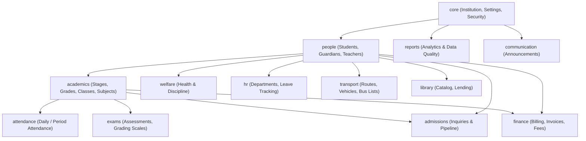

# NIZAM UNIVERSAL SCHOOL PLATFORM -- MODULE REGISTRY & DEPENDENCIES
**Product:** Nizam Universal School Platform  
**System:** Module Manager & Feature Registry Architecture  
**Document Version:** 1.0.0

---

## 1. Architectural Principles

Nizam enforces **Modular School Operations**:
1. **No Bloat:** Schools activate only the operational modules they genuinely need.
2. **Safe Deactivation:** Disabling a module immediately removes its navigation links, denies its web routes, and hides its dashboard widgets while strictly preserving underlying database tables and records.
3. **Dependency Integrity:** A module cannot be enabled if its prerequisites are missing or disabled.
4. **No Fake Modules:** Every registered module possesses full MVC implementations (routes, controller, service, repository, views, and translations).

---

## 2. Universal Module Catalog

| Module Key | Category | Core? | Dependencies | Default State | Description |
|---|---|---|---|---|---|
| `core` | Foundation | Yes | None | Enabled | Institution identity, settings, academic years, roles, permissions, audit logs. |
| `people` | SIS | Yes | `core` | Enabled | Student directory, guardian relationships, teacher directory, user management. |
| `academics` | SIS | Yes | `core`, `people` | Enabled | Educational stages, grade levels, classes, subjects, teacher assignments, timetables. |
| `attendance` | Operations | Yes | `academics` | Enabled | Daily & period attendance, attendance codes, absence tracking, notifications. |
| `exams` | Assessment | Yes | `academics` | Enabled | Exam sessions, grading scales, score recording, rankings, report cards. |
| `welfare` | Wellbeing | Yes | `people` | Enabled | Student discipline records, rewards, medical/health records with restricted access. |
| `reports` | Intelligence | Yes | `core` | Enabled | Central reporting center, data exports, school intelligence dashboard. |
| `admissions` | Admissions | No | `people`, `academics` | Enabled | Inquiry management, applications pipeline, entrance assessment, enrollment conversion. |
| `finance` | ERP | No | `people`, `academics` | Optional | Fee categories, fee structures, student invoices, receipts, payment recording. |
| `hr` | ERP | No | `people` | Optional | Staff departments, designations, leave management, staff directory. |
| `transport` | Operations | No | `people` | Optional | Bus routes, vehicle fleet, drivers, student transport allocations. |
| `library` | Operations | No | `people` | Optional | Book catalog, ISBN management, borrowing/return checkout, overdue fine tracking. |
| `communication` | Community | Yes | `core`, `people` | Enabled | School circulars, targeted announcements, notice boards. |

---

## 3. Module Dependency Graph



---

## 4. Module Registry Service Design (`App\Services\ModuleManager`)

The `ModuleManager` is a singleton service that queries the `installed_modules` table and provides fast, cached lookups during request lifecycle:

```php
namespace App\Services;

class ModuleManager
{
    /** Returns true if the module key is currently enabled. */
    public function isEnabled(string $moduleKey): bool;

    /** Returns all installed modules with their metadata and activation state. */
    public function all(): array;

    /** Toggles module activation after checking dependency tree. */
    public function setEnabled(string $moduleKey, bool $enabled): array;

    /** Validates whether all dependencies for a module are satisfied. */
    public function canEnable(string $moduleKey): array;

    /** Returns list of active navigation items filtering out disabled modules. */
    public function getActiveNavItems(): array;
}
```

---

## 5. Route Protection & Enforcement Strategy

When a user attempts to access a route belonging to a disabled module:
1. `ModuleGateMiddleware::requiresModule('finance')` checks `ModuleManager::isEnabled('finance')`.
2. If disabled, the middleware terminates the request:
   - For web GET requests: redirects to `/dashboard` with a localized flash warning: `"The requested module (:module) is not activated for this school."`
   - For API / POST requests: returns HTTP 403 Forbidden with `{ "error": "MODULE_DISABLED", "module": "finance" }`.
3. The application layout dynamically excludes disabled modules from the sidebar, preventing dead links.
