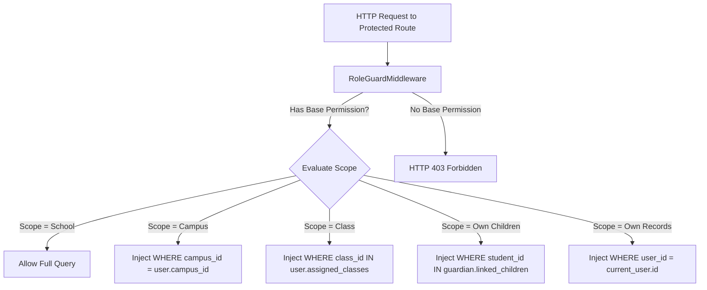

# NIZAM UNIVERSAL SCHOOL PLATFORM -- ROLE-BASED ACCESS CONTROL (RBAC) & PERMISSION MATRIX
**Product:** Nizam Universal School Platform  
**Architecture:** Enterprise-Grade Scoped RBAC  
**Document Version:** 1.0.0

---

## 1. Principles of Authorization in Nizam

1. **Server-Side Enforcement:** Permissions and data scopes are enforced inside controllers, middleware, and database queries. A user cannot access or manipulate data merely by altering a URL, parameter, or dropdown.
2. **Backward Compatibility:** All existing 36 permission codes and the 2 initial roles (`admin`, `staff`) remain fully operational and preserved.
3. **18 Standardized Role Templates:** Configurable role templates support diverse institutional structures without requiring hardcoded logic.
4. **Contextual & Scoped Access:** Permissions can be evaluated at granular scopes:
   - `school`: Access all records across the institution.
   - `campus`: Access records within the user's assigned campus.
   - `grade`: Access records for assigned grade levels.
   - `class`: Access records only for assigned classes/sections.
   - `own_records`: Access only records authored or assigned to the user.
   - `own_children`: Access only records of students linked through verified `student_guardians` junction.

---

## 2. Standardized Role Templates

| Role Code | Role Name (EN) | Role Name (AR) | Primary Operational Scope | Focus & Responsibilities |
|---|---|---|---|---|
| `admin` | Platform Administrator | مدير المنصة | School-wide | Full system configuration, backups, user management, and security. |
| `owner` | School Owner / Board | مالك المدرسة / مجلس الإدارة | School-wide | Strategic dashboards, high-level financials, enrollment growth, compliance. |
| `principal` | School Principal | مدير المدرسة | School-wide | Operational oversight, staff supervision, student discipline, approvals. |
| `director` | Academic Director | المشرف الأكاديمي | School-wide | Curriculum, timetable, teacher workloads, examinations, report cards. |
| `registrar` | Registrar | مسجل شؤون الطلاب | Campus / School | Student enrollment, class assignments, promotions, transfers, alumni. |
| `admissions` | Admissions Officer | مسؤول القبول والتسجيل | Campus / School | Inquiries, entrance assessments, application reviews, offers. |
| `teacher` | Teacher | معلم | Class / Subject | Assigned classes, timetable, lesson attendance, score entry. |
| `class_teacher` | Class / Form Teacher | رائد الفصل | Class | Class-level daily attendance, behavioral notes, report card verification. |
| `attendance_officer` | Attendance Supervisor | مسؤول الغياب والحضور | Campus / School | Daily attendance reconciliation, truancy tracking, guardian alerts. |
| `accountant` | Accountant / Bursar | المحاسب المالي | School-wide | Fee structures, invoices, payment receipts, expense vouchers, billing. |
| `hr_officer` | HR Manager | مسؤول الموارد البشرية | School-wide | Staff contracts, leave requests, employee records, attendance. |
| `student_affairs` | Student Affairs Officer | أخصائي شؤون الطلاب | Campus / School | Behavioral infractions, positive recognitions, student welfare cases. |
| `health_officer` | Health / Clinic Officer | الطبيب / الزائرة الصحية | Campus / School | Medical records, clinic visits, chronic conditions, health alerts. |
| `librarian` | Librarian | أمين المكتبة | School-wide | Book catalog, lending, returns, reservations, overdue management. |
| `transport_manager` | Transport Supervisor | مشرف النقل المدرسي | School-wide | Bus routes, vehicle fleet, drivers, student bus allocations. |
| `parent` | Parent / Guardian | ولي الأمر | Own Children | View linked children's attendance, grades, report cards, fee invoices. |
| `student` | Student | الطالب | Own Records | View personal timetable, exam scores, report cards, announcements. |
| `auditor` | Read-only Auditor | مراجع داخلي / مدقق | School-wide (Read-only) | Read-only inspection of academic logs, financial receipts, audit trails. |

---

## 3. Comprehensive Permission Catalog

### 3.1 Core & System Administration
- `settings.manage` -- Manage school profile, configuration, and modules.
- `users.manage` -- Create and assign roles and accounts.
- `activity_log.view` -- View immutable security audit logs.
- `backups.run` -- Generate manual or scheduled database backups.
- `backups.restore` -- Restore previous database snapshots.

### 3.2 Academic Management
- `academic_years.view` / `academic_years.manage` / `academic_years.close` -- Academic sessions and calendar.
- `grades.view` / `grades.manage` -- Educational stages and grade levels.
- `subjects.view` / `subjects.manage` -- Subject catalog and staffing requirements.
- `classes.view` / `classes.manage` -- Class sections and room assignments.
- `timetable.view` / `timetable.manage` -- Bell schedules and class timetables.

### 3.3 People & Student Information
- `students.view` / `students.create` / `students.edit` / `students.archive` / `students.restore` / `students.promote` -- Student registry.
- `guardians.view` / `guardians.manage` -- Guardian directory and sibling linkages.
- `teachers.view` / `teachers.create` / `teachers.edit` / `teachers.archive` -- Teacher directory.
- `assignments.view` / `assignments.manage` -- Teacher-to-class-subject assignments.

### 3.4 Admissions & Enrollment
- `admissions.view` -- View prospective inquiries and applications.
- `admissions.manage` -- Process applications, schedule assessments, issue decisions.
- `admissions.convert` -- Convert accepted applicant to enrolled student and linked guardian.

### 3.5 Daily Attendance & Absence
- `attendance.view` -- View attendance records and reports.
- `attendance.manage` -- Mark daily or period attendance.

### 3.6 Examinations, Grading & Assessment
- `exams.view` -- View examination schedules and results.
- `exams.manage` -- Create exams, configure grading scales, record scores, publish report cards.

### 3.7 Student Support, Welfare & Health
- `welfare.view` -- View general disciplinary records and rewards.
- `welfare.manage` -- Record behavioral incidents and actions taken.
- `health.view` -- Contextual access to medical conditions and clinic logs.
- `health.manage` -- Manage restricted clinic visits and health notices.

### 3.8 Finance & Revenue (Modular)
- `finance.view` -- View fee structures, student invoices, and payment histories.
- `finance.manage` -- Create fee structures, generate billing invoices, issue receipts.

### 3.9 Human Resources (Modular)
- `hr.view` -- View staff departments, designations, and employee records.
- `hr.manage` -- Process leave requests and staff documentation.

### 3.10 Operations: Transport & Library (Modular)
- `transport.view` / `transport.manage` -- Bus routes, vehicles, student passenger lists.
- `library.view` / `library.manage` -- Book catalog, checkout, returns, overdue tracking.

### 3.11 Communication & Community
- `notifications.view` / `notifications.manage` -- Publish notices, circulars, and announcements.

### 3.12 Reports & Analytics
- `reports.view` -- View academic, attendance, and operational reports.
- `reports.export` -- Export datasets in CSV, PDF, or OneRoster formats.

---

## 4. Permission Scoping Implementation

