# NIZAM UNIVERSAL SCHOOL PLATFORM -- SCHOOL ONBOARDING & SETUP GUIDE
**Product:** Nizam Universal School Platform  
**System:** Institutional Onboarding & Initial Setup Wizard  
**Document Version:** 1.0.0

---

## 1. Overview

Nizam provides a comprehensive, self-service **11-Step Onboarding Wizard** that enables any educational institution to configure and launch its operational SIS/ERP environment without requiring direct database access or manual SQL script execution.

---

## 2. The 11-Step Onboarding Lifecycle

```mermaid
flowchart LR
    S1[1. Identity] --> S2[2. Structure]
    S2 --> S3[3. Academic Year]
    S3 --> S4[4. Curriculum]
    S4 --> S5[5. Assessment]
    S5 --> S6[6. Scheduling]
    S6 --> S7[7. Attendance]
    S7 --> S8[8. Modules]
    S8 --> S9[9. Users & Roles]
    S9 --> S10[10. Data Import]
    S10 --> S11[11. Verification]
```

### Step 1 — Institution Identity
- Official school name in primary language and English.
- School emblem / official logo upload (`schools.logo_path`).
- Physical address, contact phone, official email, website.
- Country, administrative region, time zone.
- Default system language (`ar` or `en`) and available locale switcher.
- Local currency (`EGP`, `SAR`, `AED`, `USD`, etc.) and date format (`YYYY-MM-DD`).

### Step 2 — Institution Structure & Campuses
- Institutional Type: Public, Private, Language, International, Primary, Secondary, K-12.
- Educational Stages: Select applicable stages (e.g. Primary, Preparatory, Secondary, or Elementary, Middle, High).
- Campus Topology: Single campus or Multi-campus configuration with branch naming and addresses.

### Step 3 — Academic Year & Calendar
- Academic Year label (e.g. `2026/2027`).
- Start Date and End Date.
- Academic Term Division: 2 Semesters, 3 Trimesters, or 4 Quarters.
- Official school holidays and non-instructional days.

### Step 4 — Curriculum & Subject Catalog
- Curriculum Framework: National, Cambridge, American, IB, or Custom School Catalog.
- Core subjects definition (Mathematics, Science, Arabic, English, History, etc.) with code, credits, and classification.
- Subject-to-grade mapping.

### Step 5 — Assessment & Grading Policies
- Primary Grading Scale:
  - 100-Point Percentage scale.
  - Letter Grade scale (A+, A, B, C, D, F).
  - 4.0 GPA scale.
  - Competency rubric bands.
- Assessment Weightings: Formative homework, mid-term tests, practicals, final examination weighting.
- Minimum passing score threshold and promotion requirements.

### Step 6 — Scheduling & Timetable
- Active School Week: Sunday-Thursday or Monday-Friday.
- Daily Timetable: Number of periods per day (typically 6-8 periods).
- Bell Schedule: Period start times, durations, and break / assembly periods.
- Physical Rooms: Classroom numbers, laboratories, halls, and capacity ceilings.

### Step 7 — Attendance Rules & Policies
- Attendance Mode: Daily homeroom roll call, period-by-period timetable attendance, or both.
- Attendance Codes: Present, Absent, Late Arrival, Excused Absence.
- Late Arrival Policy: Threshold minutes before marking a student tardy vs absent.
- Absence Notification: Automated alert triggers for parents upon unexcused absences.

### Step 8 — Module Activation & Dependency Review
- Review and toggle optional modules based on school requirements:
  - `admissions`: Inquiry tracking, entrance assessments, online applications.
  - `finance`: Tuition fee structures, invoices, payment receipts, balance tracking.
  - `hr`: Staff departments, employee profiles, leave request approval workflow.
  - `transport`: Bus routes, vehicle fleet, driver assignments, passenger manifests.
  - `library`: Book catalog, lending checkout desk, overdue tracking.
- Dependency verification: Ensuring prerequisites are enabled before dependent modules activate.

### Step 9 — Administrative Users & Role Assignments
- Super Administrator credentials (username, strong password, email).
- Initial staff role templates (Principal, Academic Director, Registrar, Accountant, etc.).
- Departmental access credentials.

### Step 10 — Data Import & Migration
- Download standardized CSV import templates for Students, Guardians, Teachers, and Classes.
- Upload existing spreadsheets:
  1. Format and encoding validation.
  2. Column mapping.
  3. Reference integrity and duplicate detection (national IDs, phone numbers, codes).
  4. Preview and validation summary (valid rows vs error rows).
  5. Atomic transactional commit.

### Step 11 — Verification & Operational Readiness Audit
- Automated system health check:
  - Active academic year confirmed.
  - Minimum grade levels and active classes configured.
  - Teachers assigned to curriculum subjects.
  - Backup verified.
- Summary readiness scorecard showing operational green status.
- One-click launch into the live Nizam School Dashboard!
