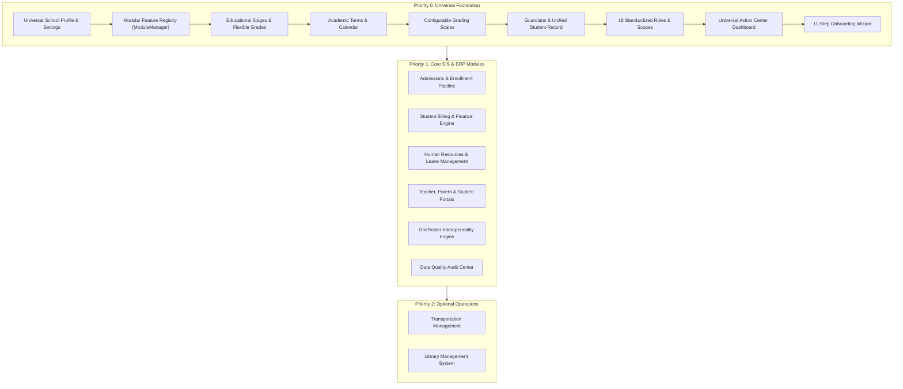

# NIZAM UNIVERSAL SCHOOL PLATFORM -- GAP ANALYSIS & CAPABILITY AUDIT
**Date:** 2026-11-09  
**Repository:** `11Mazen22/nizam-school-system`  
**Baseline Commit:** `e0fe57d` / `97fb1c8`  
**Target:** Universal K-12 School Management Platform (SIS + School ERP)

---

## 1. Executive Summary

A comprehensive architectural and functional audit of the Nizam codebase was conducted against the Universal School Platform specification. Nizam was originally engineered as an institution-specific school administrative system for "Hadaba Al-Ahram Language School" with a solid PHP 8.2 MVC foundation, strict PDO repositories, MySQL/PostgreSQL dual-dialect support, CSRF protection, and a modern light-mode design system.

To fulfill its mission as a universal, configurable, modular K-12 School Information System (SIS) and School ERP, Nizam must transition from hardcoded assumptions to a dynamic, configurable foundation.

---

## 2. Capability Gap Matrix

| Domain & Capability | Current State | Required Universal Capability | Priority | Dependencies | Architectural Decision |
|---|---|---|---|---|---|
| **01. System Identity & Profile** | Hardcoded school name ("Hadaba Al-Ahram"), static logo `hadaba-logo.png`, single address/phone. | Configurable school profile: multi-language names, dynamic logo upload, country, timezone, locale, currency, school week definition, school type, structure. | Priority 0 | `schools`, `settings` | Expand `schools` schema, dynamic logo in layout shell, localized metadata service. |
| **02. Multi-Campus Support** | Single school row with no campus concept. | Multi-campus architecture: central administration with campus-scoped classes, teachers, students, rooms, and timetables. | Priority 1 | `schools` | Add `campuses` table, campus scoping in repositories, central reporting rollup. |
| **03. Educational Stages & Grades** | Flat `grades` table (4 grades hardcoded in seeds). | Configurable educational stages (Kindergarten, Primary, Preparatory/Middle, Secondary/High) mapping to configurable grades. | Priority 0 | `grades` | Introduce `educational_stages` table; add `stage_id` FK to `grades`. |
| **04. Academic Calendar & Terms** | Single `academic_years` table with fixed 2 terms assumed in exams. | Configurable academic year with dynamic terms/semesters/quarters (`academic_terms` table), holidays, calendar dates. | Priority 0 | `academic_years` | Add `academic_terms` table with date boundaries, active status, and term numbering. |
| **05. Curriculum & Grading Scales** | Hardcoded 100-point numerical score model, fixed exams table. | Configurable grading scales (percentage, letter grades, GPA 4.0, competency bands) with customizable grade boundaries and weighting. | Priority 0 | `exams`, `exam_scores` | Introduce `grading_scales` & `grading_scale_bands` tables; tie assessments to configured scales. |
| **06. Student Lifecycle & Family Records** | `students` table has flat `guardian_phone`; enrollments have status enum. | Unified Person Record: dedicated `guardians` entity, `student_guardians` junction (multi-guardian, multi-child, emergency, pickup rights); full lifecycle tracking (inquiry → applicant → enrolled → active → promoted → alumni). | Priority 0 | `students`, `student_enrollments` | Create `guardians` and `student_guardians` tables; extend student profile with tabbed history. |
| **07. Admissions & Enrollment Pipeline** | Not implemented; students created directly via admin form. | Full admissions pipeline: inquiry registration, application submission, document checklist, entrance assessment, review, decision, offer, one-click enrollment conversion. | Priority 1 | `students`, `guardians`, `grades` | Create `admissions_applications` table, `AdmissionsController`, pipeline board view. |
| **08. Attendance Management** | Daily attendance per class/date with present/absent/late/excused enum. | Configurable attendance modes (daily, period/timetable-based), customizable attendance codes, calculation rules, truancy tracking. | Priority 0 | `attendance_records`, `timetables` | Introduce `attendance_codes` table; allow period-level logging linked to timetable slots. |
| **09. Role-Based Access Control (RBAC)** | 2 roles (`admin`, `staff`), 36 permissions, global scope only. | 18 standardized role templates (Owner, Principal, Academic Director, Registrar, Teacher, Accountant, HR, Librarian, Parent, Student, etc.) with scoped permissions (school, campus, grade, class, own). | Priority 0 | `roles`, `permissions`, `role_permissions` | Expand role templates, add permission scope evaluation to `RoleGuardMiddleware`. |
| **10. Modular System Registry** | Static hardcoded navigation in `app/helpers/functions.php`. | Dynamic `ModuleManager` registry with activation states, dependency checking, route gating, and conditional navigation. | Priority 0 | `settings` | Create `installed_modules` table and `ModuleManager` service; gate routes and nav dynamically. |
| **11. Finance & Student Billing** | Not implemented. | Modular fee structures, tuition plans, student invoices, payment receipts, balance tracking, discounts, installment schedules. | Priority 1 | `students`, `academic_years` | Create `fee_categories`, `fee_structures`, `student_invoices`, `invoice_payments` tables and `FinanceController`. |
| **12. Human Resources (HR)** | Flat `teachers` table with subject assignment. | Staff departments, designations, employment contracts, leave requests & approval workflows, staff directory. | Priority 1 | `teachers`, `users` | Create `staff_departments`, `staff_designations`, `staff_leaves` tables and `HrController`. |
| **13. Role-Specific Workspaces** | Single admin shell; staff sees pruned menu. | Dedicated role workspaces: Teacher Portal (my classes, timetable, attendance, gradebook), Parent Portal (my children, grades, attendance, fees), Student Workspace (timetable, grades). | Priority 1 | `users`, `students`, `guardians` | Build dedicated portals (`/portal/teacher`, `/portal/family`, `/portal/student`) with strict data scoping. |
| **14. School Operations (Transport & Library)** | Not implemented. | Optional operational modules: Transportation (routes, vehicles, drivers, student bus allocations), Library (catalog, borrowing, overdue tracking). | Priority 2 | `students`, `installed_modules` | Create transport and library tables; register as toggleable optional modules. |
| **15. Operations Center & Action Dashboard** | High-level statistics, daily attendance bar, religion pie chart. | Role-aware operations center: daily operational status, actionable task center (unsubmitted attendance, pending admissions, capacity warnings, fee alerts), data quality auditor. | Priority 0 | `DashboardStatsService` | Redesign dashboard with context switcher (campus/term), Action Center, and Data Quality Auditor. |
| **16. School Onboarding Wizard** | 5-step basic wizard (database, schema, school, year, admin). | 11-step comprehensive onboarding wizard: Identity, Structure, Calendar/Terms, Curriculum, Assessment, Scheduling, Attendance, Modules, Roles, Import, Verification. | Priority 0 | `SetupController` | Enhance `SetupController` with multi-step configurator and operational readiness audit. |
| **17. Data Interoperability & OneRoster** | Basic CSV export/import for students, teachers, classes. | Standardized CSV/JSON data exchange compatible with 1EdTech OneRoster v1.2 specification (orgs, academicSessions, courses, classes, users, enrollments). | Priority 1 | `ImportService`, `ExportService` | Create OneRoster export/import adapters and specification mapping. |
| **18. Data Privacy & Safeguarding** | Welfare records exist (discipline, health) but lack fine-grained privacy protection. | Strict privacy-by-design: granular permission separation for sensitive health/safeguarding notes, audit trails for view actions, restricted export. | Priority 0 | `welfare_records`, `activity_logs` | Contextual access gating and immutable audit logging on sensitive student records. |

---

## 3. Implementation Phasing Strategy

---

## 4. Immediate Architectural Actions

1. **Database Migrations:** Create unified schema expansion migrations for both MySQL (`019_universal_platform_foundation.sql`) and PostgreSQL (`023_universal_platform_foundation.sql`).
2. **Module Registry:** Implement `App\Services\ModuleManager` providing activation, dependency tracking, route gating, and navigation generation.
3. **Guardians & SIS Engine:** Implement `GuardianRepository`, `StudentRepository` family tab, and lifecycle management.
4. **Admissions Pipeline:** Implement `AdmissionsService`, `AdmissionsController`, and conversion workflows.
5. **Portals:** Build dedicated workspaces for Teachers and Parents with strict ownership scoping.
6. **Finance & HR Subsystems:** Build modular controllers, services, and views with feature toggling.
7. **Testing:** Formulate and execute test suites covering all four specified school scenarios (Small Primary, Large Bilingual, International, Multi-Campus).
